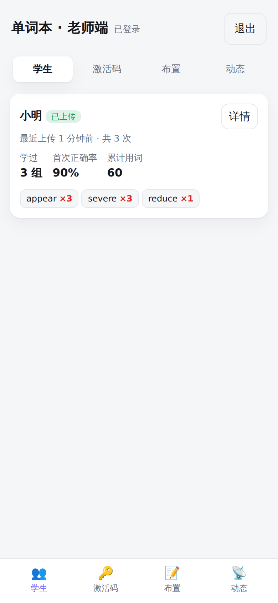

<div align="center">

# 📖 词书

**一个能自己留着、也能发给学生的背单词应用**

词库自己建 · 数据全在本地 · 服务器只帮你收作业

[](https://github.com/Supercell023/wordbook)
[](https://github.com/Supercell023/wordbook/releases)
[](https://github.com/Supercell023/wordbook)
[](https://github.com/Supercell023/wordbook)
[](LICENSE)

</div>

<div align="center">




</div>

---

## ✨ 它有什么不一样

| | 市面上的背单词软件 | 词书 |
|---|---|---|
| 词库 | 平台定，改不了 | **自己建**：中考/高考/四级/六级/雅思/托福 + 上海中考/上海高考 |
| 学习数据 | 存在别人服务器上 | **全在本地**，断网也能背，导出就是一份 JSON |
| 分组 | 算法决定，你只能跟着走 | **一组 20 词，全部点「掌握」才算过**，不熟的本组重考 |
| 复习 | 只能按它安排的来 | **按原组复习**，或**跨组随机重组 20 词** |
| 老师 | 买班级版才行 | **自带一个零依赖服务器**：激活码绑定、进度推送、AI 点评 |
| 隐私 | 学生数据进平台 | 只收昵称和进度，**不收集任何个人信息** |

## 🎯 怎么背的

```text
选词库 ─▶ 一组 20 词 ─▶ 中英文整体熟悉一遍
                          │
                          ▼
              随机抽一个英文，只有两个按钮
                  ┌───────────┐  ┌───────────┐
                  │  掌握 ✅  │  │  不熟 ✖   │
                  └─────┬─────┘  └─────┬─────┘
                        │              │
                  出队，不再考     放回本组队尾，再考
                        │              │
                        └──────┬───────┘
                               ▼
                  20 个全点过掌握 ─▶ 写入「已背词本」
                                          │
                       ┌──────────────────┴──────────────────┐
                       ▼                                     ▼
              按原组复习（可随机选组）              跨组随机重组 20 词
```

点开释义之后还有三样东西：**中英对照例句**、**同族词**（appear → appearance 名）、**音节划分**（ap·pear），单词旁边有 🔊 朗读。

## 🚀 三种用法，挑一个

### ① 一个 HTML 文件（最省事）

下载 [Releases](https://github.com/Supercell023/wordbook/releases) 里的 `vocab.html`，双击就能背。不联网、不安装、数据存在浏览器里。

### ② 安卓安装包

下载 Releases 里的 `wordbook.apk` 安装。内置原生语音（Android TextToSpeech），比网页版发音更稳。

### ③ 添加到主屏幕（iPhone 推荐）

把 `server/` 部署到一台 https 服务器，Safari 打开后「分享 → 添加到主屏幕」，得到一个全屏、可离线、能发音的「网页 App」。iOS 不能侧载，这是免签名方案；需要真机安装就用 `ios/` 里的 Xcode 工程。

## 🗂 词库

| 词库 | 词数 | 例句覆盖 |
|---|---:|---:|
| 中考 | 1,228 | 100% |
| 高考 | 3,296 | 100% |
| 四级 | 3,817 | 100% |
| 六级 | 5,391 | 100% |
| 雅思 | 4,946 | 99.6% |
| 托福 | 6,949 | 95.1% |
| 上海中考 | 1,610 | 100% |
| 上海高考 | 6,135 | 100% |

（一个词可以属于多个词库，所以加起来不等于总数）

合计 **12,115** 词，例句覆盖 **97.2%**（11,773 条），同族词覆盖 **49.6%**（6,007 个），音节全部自动切分（8,823 个多音节词）。

> 雅思、托福没有官方词表（ETS 和英国文化协会都没发布过），这里用的是社区整理版，来自 ECDICT 的考试标签。

## 🏗 架构

```text
  ECDICT ─┐
  上海中考 ─┼─▶ tools/build.py ─▶ dist/vocab.html（2.5MB 单文件）
  上海高考 ─┤        │                  ├─▶ 浏览器直接打开
  Tatoeba ─┘        │                  ├─▶ server/public ─▶ 学生手机
  WordNet ──────────┘                  ├─▶ android/assets ─▶ APK
                                       └─▶ ios/Resources ─▶ WKWebView

  学生端（localStorage）──手动推送──▶ server.js ──▶ 老师端 admin.html
                                         │
                                         └──▶ 大模型 / 本地规则 ─▶ AI 点评
```

- **不需要数据库**：老师端数据就是一个 `db.json`
- **不需要后台常驻进程**：学习过程纯前端，服务器挂了也能背
- **不需要 Gradle**：APK 用 `aapt + javac + d8 + apksigner` 手工打

## 🛠 本地构建

```bash
# 词库（需要 Python 3.10+）
pip install -r tools/requirements.txt
curl -L -o data/ecdict.csv \
  https://raw.githubusercontent.com/skywind3000/ECDICT/master/ecdict.csv
./build.sh                 # 生成 dist/vocab.html 并同步到各端

# 安卓
sudo apt-get install -y openjdk-17-jdk-headless aapt zipalign
bash android/build.sh      # 产物 android/wordbook.apk

# 测试
cd tests && npm install && node test.js
```

## 👩‍🏫 班级版：老师能看什么

```bash
cd server && node server.js
# 学生端  http://localhost:8787/
# 老师端  http://localhost:8787/admin
```

老师端是一个适配手机的网页：

- **学生**：学了几组、首次掌握率、错词排行、每次上传的时间线
- **激活码**：一次生成一批，一人一码，绑定即作废
- **布置**：下发任务和留言，学生下次同步时收到
- **点评**：接入 DeepSeek / MIMO 等任意 OpenAI 兼容接口，没配就用本地规则分析

学生端「上传」按钮在**没有新数据时是灰的**，前后端双重去重，防止乱推。

部署到云服务器：

```bash
sudo bash server/deploy.sh --domain wb.example.com
```

自动装 Node、注册 systemd、配 Caddy 和 HTTPS。详细步骤看 [部署指南](docs/部署指南.md)。

## ✅ 测试

- **123 项功能断言**：用 jsdom 真实加载 `dist/vocab.html`，模拟点击走完学习、复习、生词本、拼写、迁移等全部流程
- **布局检查**：用 Chromium 量每个页面的元素边界，保证 360px 宽度下没有横向溢出
- **服务器测试**：25 项接口断言（激活码、去重、越权、伪造令牌）

## 📚 文档

- [使用说明](docs/使用说明.md) —— 学生怎么背、老师怎么看
- [部署指南](docs/部署指南.md) —— 从零到一台能用的服务器
- [架构说明](docs/架构.md) —— 数据结构、分组算法、接口清单
- [数据来源](data/README.md) —— 每个文件从哪来、什么许可

## 📜 许可

代码 [MIT](LICENSE)。词库和例句来自第三方，各自的许可见 [data/README.md](data/README.md)：ECDICT（MIT）、上海高考开放词库（CC BY 4.0）、Tatoeba（CC BY 2.0 FR）。

上海中考词汇表原表版权归上海市教委 / 上海教育出版社，仓库里只随附抽取后的词表，供个人学习使用。如果权利人认为不妥，提一个 issue，我会立即移除。
